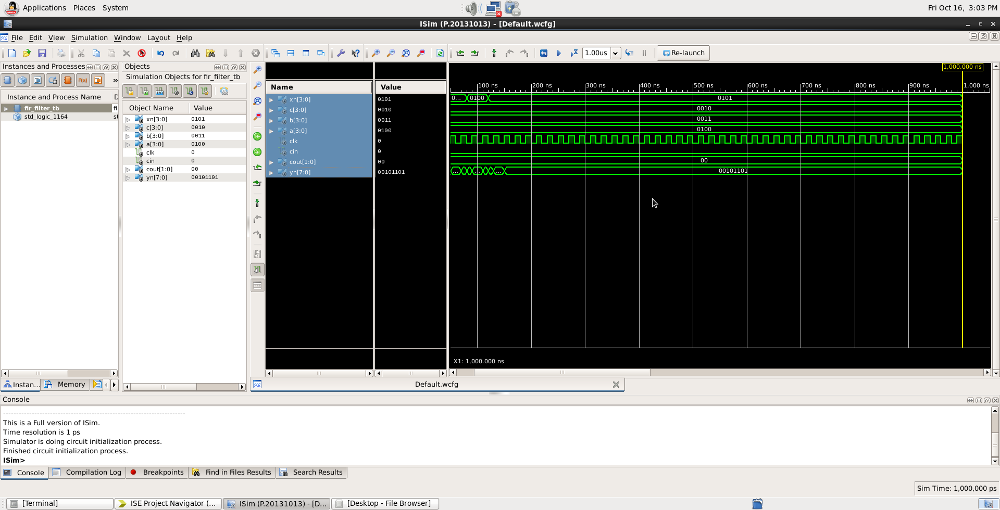
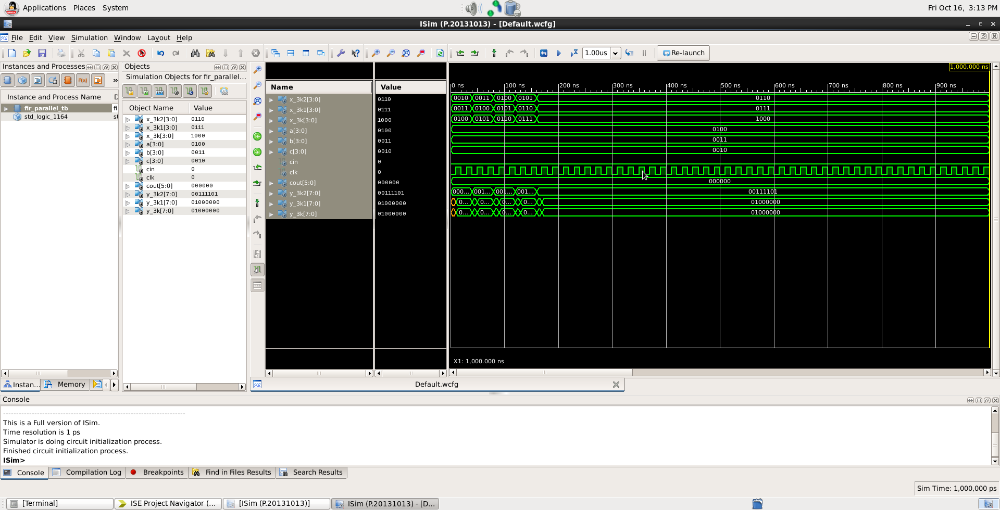

# FIR Filter Implementations in VHDL

VHDL implementations of normal and parallel-processed FIR filters using component instantiation.

## Project Overview

This project explores digital filter design using VHDL and modular hardware components.

## Architecture

### 1. Normal FIR Filter

The normal FIR implementation uses component-based structural VHDL. Four-bit multipliers generate the coefficient-weighted products, 8-bit ripple-carry adders combine intermediate results, and D flip-flops register intermediate values.

The design uses the coefficients `a`, `b`, and `c`, with `Xn` as the input sample.

### 2. Parallel-Processed FIR Filter

The parallel implementation accepts three input-sample values: `x_3k2`, `x_3k1`, and `x_3k`. Multiple multiplier and adder paths calculate the three output values `y_3k2`, `y_3k1`, and `y_3k`.

The design uses instantiated arithmetic components and D flip-flops in selected paths.

### Design and Verification Tools

- VHDL
- Xilinx ISE
- ISim behavioral simulation
- Post-place-and-route static timing analysis

### Verification Notes

Both designs have simulation waveforms and timing reports. Timing results are specific to the selected implementation settings. A performance advantage for the parallel architecture has not yet been established.

### Implementations
- **Normal FIR:** A filter design using multipliers, adders, and D flip-flops.
- **Parallel-Processed FIR:** A multi-path implementation using instantiated arithmetic components.

## Tools Used
- VHDL
- Xilinx ISE
- ISim Simulator

## Simulation Results

## Static Timing Analysis

Both FIR architectures were synthesized and implemented
using Xilinx ISE, followed by post-place-and-route
static timing analysis.

### Timing Results

| Parameter | Normal FIR | Parallel FIR |
|-----------|------------|--------------|
| Maximum Pad-to-Pad Delay | 21.408 ns | 23.234 ns |
| Maximum Clock-to-Output Delay | 15.269 ns | 21.551 ns |
| Maximum Input Setup Requirement | 13.061 ns | 4.777 ns |

### Observations

The parallel implementation contains multiple arithmetic
paths for processing three input samples.

However, the reported Pad-to-Pad delay is higher than
that of the normal implementation.

These results do not establish that the parallel
implementation has better timing performance.

The architectures have different input/output structures,
so a direct comparison of their maximum path delays
does not establish an overall performance advantage.

All timing values were obtained from Xilinx ISE
post-place-and-route analysis, without physical FPGA testing.

### Normal FIR

### Parallel-Processed FIR

## Repository Structure

- `normal-fir/` — Normal FIR design and related source files.
- `parallel-fir/` — Parallel-processed FIR design and related source files.
- `docs/` — Simulation waveform screenshots.

## Author

Adnan Lateef — Electronics and Communication Engineering student.
